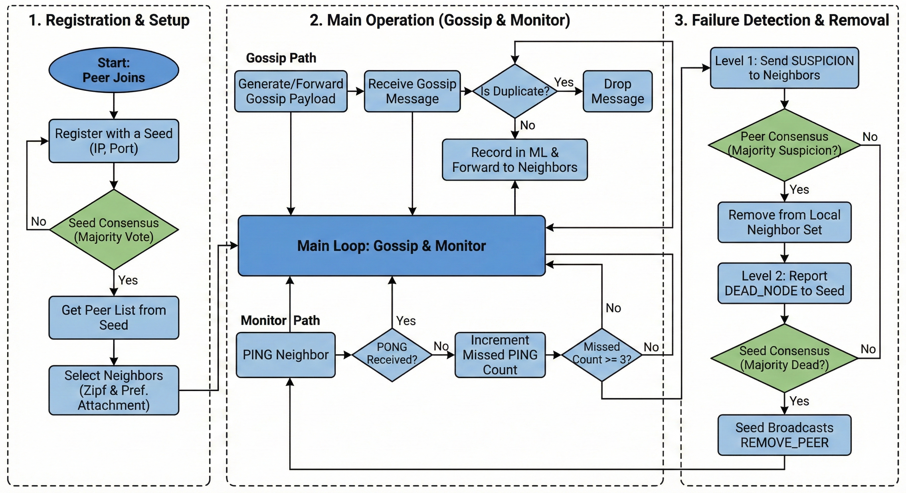
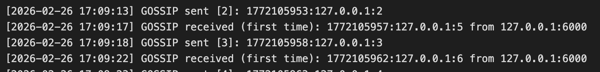
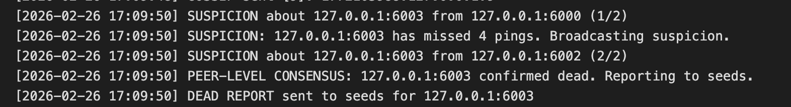
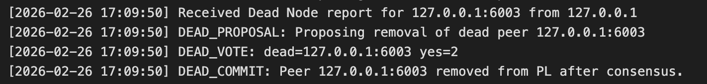

# Gossip-Based P2P Network

A gossip-based peer-to-peer network with consensus-driven membership management,
power-law degree distribution, and two-level dead-node detection.

---

## File Structure

```
gossip_p2p/
├── common.h        # Shared constants, message tags, data structures, utilities
├── seed.cpp        # Seed node implementation
├── peer.cpp        # Peer node implementation
├── config.txt      # Seed node IP:Port list (shared by all nodes)
├── Makefile        # Build system
└── README.md       # This file
```

Output files are written automatically:

- `seed_<port>_output.txt` — seed node log
- `peer_<port>_output.txt` — peer node log

---

## Build

```bash
make clean
make
```

`make clean` removes binaries and output files, then regenerates `config.txt`
with the specified number of seeds. Use the `NUM_SEEDS` parameter to control
how many seed entries are written (defaults to 3):

```bash
make clean NUM_SEEDS=5    # resets config.txt with 5 seeds (ports 5001-5005)
```

Requirements: `g++` with C++17 support, Linux/macOS (POSIX sockets).

---

## Configuration

Edit `config.txt` to list all seed nodes:

```
127.0.0.1:5001
127.0.0.1:5002
127.0.0.1:5003
```

- One `IP:Port` per line (lines starting with `#` are comments).
- The same `config.txt` is used by **all** seed and peer nodes.
- For multi-machine deployments, replace `127.0.0.1` with actual IP addresses.

---

## Running (Local Testing)

Open separate terminals for each node. All commands assume the binary and
`config.txt` are in the same working directory.

### Step 1 — Start seed nodes (one per terminal)

```bash
./seed 5001   # Terminal 1

./seed 5002   # Terminal 2

./seed 5003   # Terminal 3
```

### Step 2 — Start peer nodes (one per terminal)

```bash
./peer 6000   # Terminal 4

./peer 6001   # Terminal 5

./peer 6002   # Terminal 6

./peer 6003   # Terminal 7
```

Peers register with a quorum of seeds, collect peer lists, select neighbors
following a power-law distribution, and start gossiping every 5 seconds.
Each peer generates up to 10 gossip messages.

### Step 3 — Simulate a peer failure

Kill one of the peer processes (`Ctrl+C` or `kill <pid>`). The remaining
peers will detect the failure via missed pings, run peer-level consensus,
and report the dead node to seed nodes. Seeds run their own consensus and
remove the peer from their Peer Lists.

---

## Running on Multiple Machines

1. Edit `config.txt` with the **actual IP addresses** of the seed machines.
2. Copy `config.txt`, `seed`, and `peer` binaries to all machines.
3. Set the `SELF_IP` environment variable on each machine if `127.0.0.1`
   would be resolved incorrectly:

```bash
export SELF_IP=192.168.1.10
./seed 5000
```

```bash
export SELF_IP=192.168.1.20
./peer 6000
```

---

## Flow Diagram



---

## Protocol Overview

### Registration (Seed-Level Consensus)

```
Peer   →  Seed_A   : REGISTER:IP:Port
Seed_A →  Seed_B,C : REGISTER_PROPOSAL:IP:Port:SeedA_IP:SeedA_Port
Seed_B →  Seed_A   : REGISTER_VOTE:IP:Port:SeedB_IP:SeedB_Port:YES
                     (majority reached)
Seed_A →  Seed_B,C : REGISTER_COMMIT:IP:Port
Seed_A →  Peer     : REGISTER_OK:IP:Port
Peer   →  Seed_A   : GET_PEER_LIST
Seed_A →  Peer     : PEER_LIST:IP1:P1,IP2:P2,...
```

Example:


### Gossip Dissemination

```
Peer generates          : <timestamp>:<IP>:<MsgNum>
Peer → all neighbors    : GOSSIP:<payload>
Neighbor (first receipt): records in ML, forwards to all neighbors except sender
Neighbor (duplicate).   : silently drops
```

Example:


### Dead-Node Detection (Two-Level Consensus)

**Level 1 — Peer consensus:**

```
Peer_A pings Peer_X → no PONG (×3 missed)
Peer_A → all neighbors : SUSPICION:X_IP:X_Port:A_IP:A_Port
Peers collect suspicion reports; when majority confirm:
       → remove X from neighbor set
       → send Dead Node report to seeds
```

Example:


**Level 2 — Seed consensus:**

```
Peer_A → Seeds     : Dead Node:X_IP:X_Port:timestamp:A_IP
Seed_1 → Seed_2,3  : DEAD_PROPOSAL:X_IP:X_Port:Seed1_IP:Seed1_Port
Seed_2 → Seed_1    : DEAD_VOTE:X_IP:X_Port:Seed2_IP:Seed2_Port:YES
                     (majority reached)
Seed_1 → Seed_2,3  : DEAD_COMMIT:X_IP:X_Port
Seeds  → all peers : REMOVE_PEER:X_IP:X_Port
```

Example:


---

## Power-Law Degree Distribution

### What is a Power-Law Distribution?

In a power-law (scale-free) network, the probability that a node has degree
`k` follows:

```
P(k) ~ k^(-alpha)
```

This means **most nodes have very few connections**, while a **small number of
hub nodes accumulate many connections**. Unlike a uniform random graph where
degrees cluster around an average, a power-law network has a long tail — hubs
with 5-8 connections coexist with many nodes that have only 2-3.

Real-world examples of power-law networks include the Internet backbone,
social networks, and citation graphs. This topology provides two key
properties:

| Property               | Benefit                                                         |
| ---------------------- | --------------------------------------------------------------- |
| **Short path lengths** | Messages reach any node in few hops via hubs                    |
| **Robustness**         | Random node failures rarely disconnect the network              |
| **Efficient gossip**   | Hub nodes amplify message propagation across the network        |

### How It Works in This Project

The power-law topology is built in two steps: **Zipf sampling** to decide
*how many* neighbors a peer connects to, and **preferential attachment** to
decide *which* peers it connects to.

#### Step 1 — Zipf Sampling (neighbor count)

The function `sampleZipf(maxK, alpha=1.5)` in
[peer.cpp:77-88](peer.cpp#L77-L88) draws a random integer `k` from a
discrete Zipf distribution:

```
P(k = i) = (1/i^alpha) / SUM(j=1..maxK, 1/j^alpha)
```

With `alpha = 1.5` and `maxK = min(pool_size, 8)`, the probabilities are
heavily skewed toward small values:

```
k=1: ~48%    k=2: ~17%    k=3: ~9%    k=4: ~6%    k=5: ~4%    ...
```

After sampling, `k` is clamped to `[2, pool_size]` to guarantee every peer
has at least 2 neighbors (ensuring basic connectivity). This means most peers
end up with 2-3 neighbors, while a few get 5-8.

#### Step 2 — Preferential Attachment (neighbor choice)

Once `k` is determined, `selectNeighbors()` in
[peer.cpp:90-118](peer.cpp#L90-L118) picks *which* `k` peers to connect to
using weighted random selection:

```
weight(node) = 1 + current_degree(node)
```

- A **new node** with no existing connections has weight `1`.
- A **hub node** with 5 existing connections has weight `6` — it is **6x more
  likely** to be selected.
- Selection is done **without replacement** to avoid duplicate connections.

This creates a **"rich-get-richer"** (Matthew effect) feedback loop: nodes
that already have many connections are more likely to receive new ones,
naturally producing the power-law degree distribution over time.

#### Resulting Network Topology

```
  Degree Distribution (illustrative, 20 peers)

  Frequency
     8 │ ████
     7 │ ████
     6 │ ████ ██
     5 │ ████ ████
     4 │ ████ ████ ██
     3 │ ████ ████ ████
     2 │ ████ ████ ████ ██
     1 │ ████ ████ ████ ████ ██
     0 └──────────────────────────
          2     3    4    5   6+     Degree (k)

  Most peers: 2-3 neighbors (low degree)
  Few hubs:   5-8 neighbors (high degree)
```

#### Topology Maintenance

The global adjacency list `g_topology` (a `map<string, set<string>>`)
tracks every edge in the network:

- **`addEdge(a, b)`** — called when a new neighbor connection is established;
  adds the edge in both directions.
- **`removeEdge(a, b)`** — called on dead-node removal; cleans up both
  directions.
- **Thread-safe** — all reads and writes are protected by `g_topoMu` mutex,
  since multiple threads handle connections concurrently.

When a peer is removed (detected dead), its edges are cleaned from
`g_topology`, and the reduced degrees naturally influence future neighbor
selections by new peers joining the network.

---

## Security Analysis

| Attack                              | Mitigation                                                            |
| ----------------------------------- | --------------------------------------------------------------------- |
| **False dead report** (single peer) | Peer-level majority required before reporting to seeds                |
| **Colluding peers**                 | Seed-level majority independently confirms before removal             |
| **Sybil registration**              | Seeds exchange proposals/votes; single seed cannot unilaterally admit |
| **False suspicion flood**           | Suspicion deduplicated per suspected node; quorum threshold           |
| **Replay attacks**                  | Each message carries a timestamp; ML hash deduplication               |

---

## Logging

All events are written to both **stdout** and an **output file**:

| Node        | Output file            |
| ----------- | ---------------------- |
| `seed 5000` | `seed_5000_output.txt` |
| `peer 6001` | `peer_6001_output.txt` |

Logged events include:

- Seed: registration proposals, consensus votes, commits, dead-node removals
- Peer: received peer lists, first-time gossip messages (with timestamps/sender IPs),
  confirmed dead-node reports
