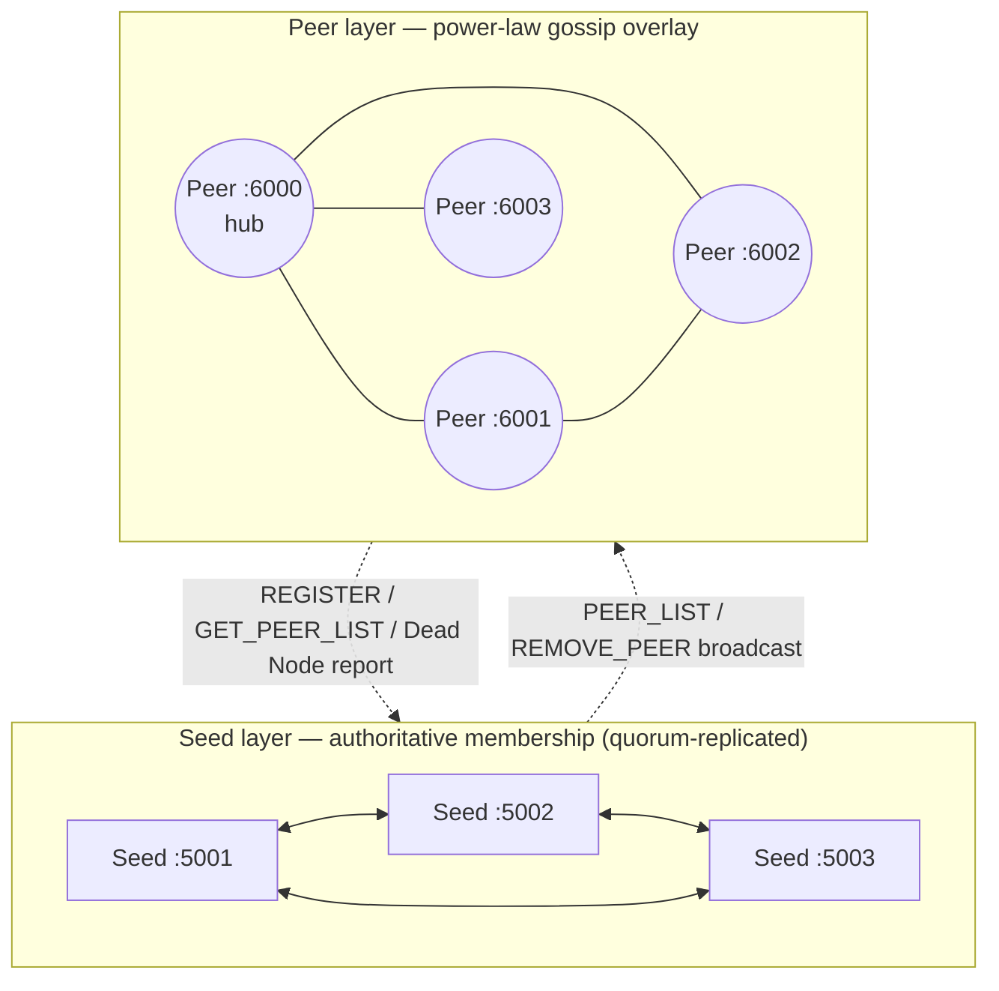
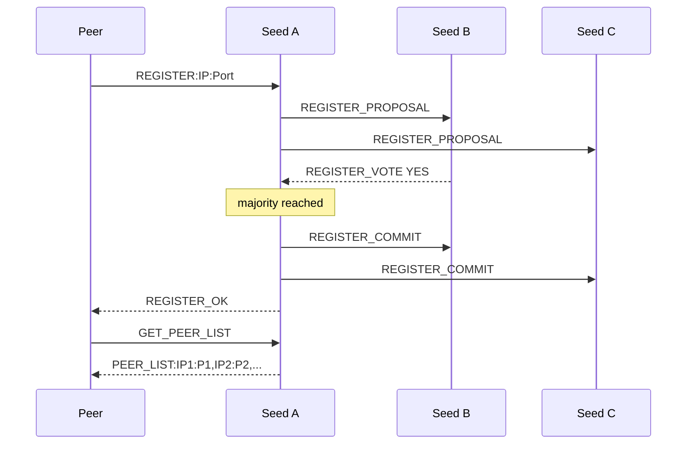
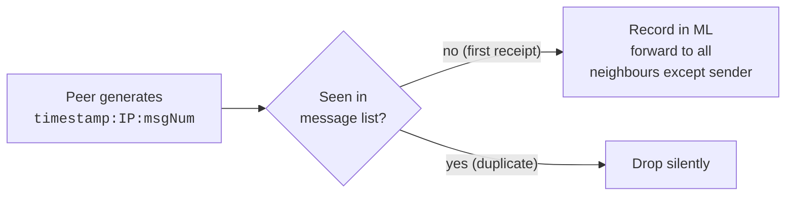
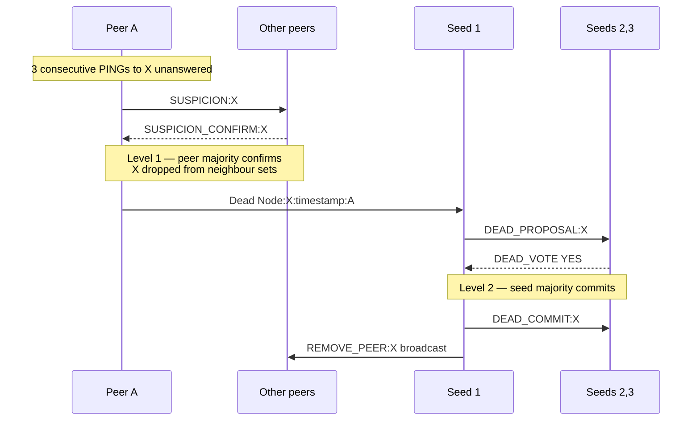

# P2P Gossip Network

A gossip-based peer-to-peer network in C++17 where **membership is agreed on by
consensus, not asserted by any single node**. Peers join through a quorum of
seed nodes, wire themselves into a power-law (scale-free) topology, gossip
messages with duplicate suppression, and evict crashed peers through two
independent rounds of majority voting.

<p>


</p>

```bash
git clone https://github.com/SreenityaThatikunta/P2P-Gossip-Network.git
cd P2P-Gossip-Network && ./scripts/demo.sh
```

One command builds the project, starts 3 seeds and 4 peers, lets them gossip,
kills a peer, and prints the consensus that removes it. Sample output from a
previous run is checked into [`logs/`](logs/).

---

## What this project demonstrates

| Area | What's implemented |
| --- | --- |
| **Distributed consensus** | Propose → vote → commit across seed nodes for both joins and evictions; no seed can admit or evict a peer alone |
| **Failure detection** | Two-level detection — peer-level suspicion quorum, then independent seed-level quorum, so one lying peer cannot evict another |
| **Network topology** | Zipf-sampled degree + preferential attachment produce a scale-free graph with hubs, built at runtime from live degree data |
| **Epidemic protocols** | Gossip with message-list deduplication — each peer acts on a message once and forwards it on, so floods terminate without a TTL or hop count |
| **Systems programming** | Raw POSIX sockets, one thread per connection plus periodic ping/gossip threads, all shared state mutex-guarded |
| **Zero dependencies** | ~1,400 lines of C++17 and a Makefile — no frameworks, no RPC library |

---

## Architecture



The seed layer is the **membership authority**: every change to the peer list
passes a majority vote, so the layer stays consistent even if a minority of
seeds is unreachable. The peer layer is **self-organising**: peers pick their
own neighbours from the peer list and need no seed involvement to gossip.

### Repository layout

```
├── common.h          # Message tags, shared structs, logger, socket helpers
├── seed.cpp          # Seed node: registration + dead-node consensus, peer list
├── peer.cpp          # Peer node: topology selection, gossip, ping, suspicion
├── scripts/demo.sh   # One-command local network + failure simulation
├── logs/             # Sample run logs (3 seeds, 4 peers, one induced failure)
├── assets/           # Annotated screenshots of real runs
├── config.txt        # Seed IP:Port list, shared by every node
└── Makefile          # Build + config.txt generation
```

---

## Protocol walkthrough

### 1. Registration — seed-level consensus

A peer is admitted only after a majority of seeds vote for it.



Each peer registers with ⌊n/2⌋+1 seeds and unions the peer lists it receives,
so a single stale seed cannot hide part of the network from it.

<details>
<summary>Real log output</summary>


</details>

### 2. Gossip dissemination



Each peer emits one message every 5 s, up to 10 messages, identified by
`timestamp:IP:msgNum`. The message list makes forwarding idempotent: a message
crosses each edge at most once per direction, so the flood terminates without
any TTL or hop count.

<details>
<summary>Real log output</summary>


</details>

### 3. Dead-node detection — two-level consensus

The interesting part: **a peer's suspicion is not enough to evict it, and the
seeds don't take a peer's word for it either.**



Liveness uses a 3 s ping interval, a 5 s timeout and a threshold of 3 missed
pings, so a peer is suspected after roughly 9–15 s of silence rather than on a
single dropped packet.

<details>
<summary>Real log output</summary>


</details>

### End-to-end flow


---

## Power-law degree distribution

### Why a scale-free topology

In a power-law network the probability a node has degree `k` is
`P(k) ~ k^(-alpha)`: **most nodes have very few connections while a few hubs
accumulate many**. Unlike a uniform random graph, whose degrees cluster around
the mean, this gives a long tail — hubs with 5–8 links alongside many nodes
with 2–3.

| Property | Benefit for gossip |
| --- | --- |
| **Short path lengths** | Messages reach any node in few hops via hubs |
| **Robustness** | Random failures hit low-degree nodes and rarely partition the graph |
| **Efficient dissemination** | Hubs amplify propagation, so few redundant sends are needed |

### How it's built

**Step 1 — Zipf sampling picks *how many* neighbours.**
`sampleZipf(maxK, alpha=1.5)` ([peer.cpp:44](peer.cpp#L44)) draws `k` from a
discrete Zipf distribution, `P(k=i) = (1/i^alpha) / Σ(1/j^alpha)`. With
`alpha = 1.5` and `maxK = min(pool_size, 8)` the mass sits on small values:

```
k=1: ~48%    k=2: ~17%    k=3: ~9%    k=4: ~6%    k=5: ~4%    ...
```

`k` is then clamped to `[2, pool_size]` so every peer keeps at least two
neighbours — the floor that prevents a trivially disconnected overlay.

**Step 2 — Preferential attachment picks *which* neighbours.**
`selectNeighbors()` ([peer.cpp:61](peer.cpp#L61)) samples `k` peers without
replacement, weighted by `weight(node) = 1 + current_degree(node)`. A fresh
node has weight 1; a hub with five links has weight 6 and is six times more
likely to be chosen. That rich-get-richer loop is what produces the power law
as peers join.

**Topology bookkeeping.** `g_topology` (`map<string, set<string>>`) holds the
adjacency list; `addEdge` / `removeEdge` maintain both directions and every
access is guarded by `g_topoMu`, since connection-handler threads read and
write it concurrently. When a peer is evicted its edges are removed, and the
lowered degrees immediately feed back into later neighbour selection.

```
  Degree distribution (illustrative, 20 peers)

  Frequency
     8 │ ████
     7 │ ████
     6 │ ████ ██
     5 │ ████ ████
     4 │ ████ ████ ██
     3 │ ████ ████ ████
     2 │ ████ ████ ████ ██
     1 │ ████ ████ ████ ████ ██
     0 └──────────────────────────
          2     3    4    5   6+     Degree (k)
```

---

## Threat model

| Attack | Mitigation |
| --- | --- |
| **False dead report** (single peer) | Peer-level majority required before anything reaches the seeds |
| **Colluding peers** | Seed-level majority independently confirms before removal |
| **Sybil registration** | Seeds exchange proposals and votes; no single seed can admit a peer |
| **False suspicion flood** | Suspicions deduplicated per suspected node, with a quorum threshold |
| **Replay** | Every message carries a timestamp; message-list deduplication drops repeats |

---

## Running it manually

```bash
make clean && make          # build; `make clean NUM_SEEDS=5` regenerates config.txt
```

Requires `g++` with C++17 and a POSIX platform (Linux/macOS). `config.txt`
lists one `IP:Port` per line and is shared by every node — swap `127.0.0.1`
for real addresses to run across machines.

```bash
./seed 5001   # terminal 1          ./peer 6000   # terminal 4
./seed 5002   # terminal 2          ./peer 6001   # terminal 5
./seed 5003   # terminal 3          ./peer 6002   # terminal 6
```

Kill any peer (`Ctrl+C`) to watch detection and both consensus rounds play
out. Every node mirrors its events to stdout and to
`seed_<port>_output.txt` / `peer_<port>_output.txt`.

| Tunable | Default | Where |
| --- | --- | --- |
| Gossip interval / message cap | 5 s / 10 msgs | [common.h](common.h) |
| Ping interval / timeout | 3 s / 5 s | [common.h](common.h) |
| Missed-ping threshold | 3 | [common.h](common.h) |
| Zipf exponent / max degree | 1.5 / 8 | [peer.cpp](peer.cpp) |

---

## Design notes and limitations

- **Quorum over strong consensus.** Registration and eviction use a
  single-round propose/vote/commit majority rather than full Raft or Paxos:
  enough to prevent unilateral membership changes, but it does not survive a
  proposer crashing mid-commit. Leader election and log replication would be
  the next step.
- **Detection latency is deliberate.** Three missed pings before suspicion
  trades fast detection for far fewer false positives on a loaded machine.
- **TCP, thread-per-connection.** Simple and easy to reason about; an
  epoll/kqueue event loop would be the move past a few hundred peers.
- **Not hardened against a malicious majority.** The threat model assumes
  honest-majority seeds; message signing would be needed otherwise.
- **Message IDs collide on a single host.** The gossip ID is
  `timestamp:IP:msgNum` with no port, so two peers on `127.0.0.1` that emit
  their *n*-th message in the same second produce the same ID and each drops
  the other's as a duplicate — visible in `logs/` as a peer with fewer
  first-time receipts than its neighbours. Including the port (or a per-peer
  UUID) in the ID fixes it; across distinct hosts the ID is already unique.

## License

[MIT](LICENSE)
